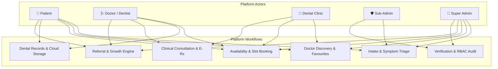
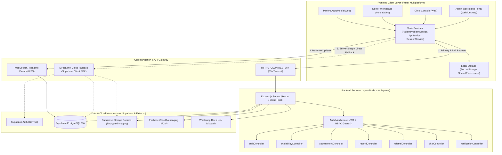
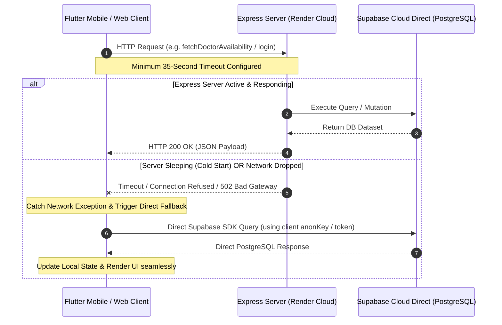
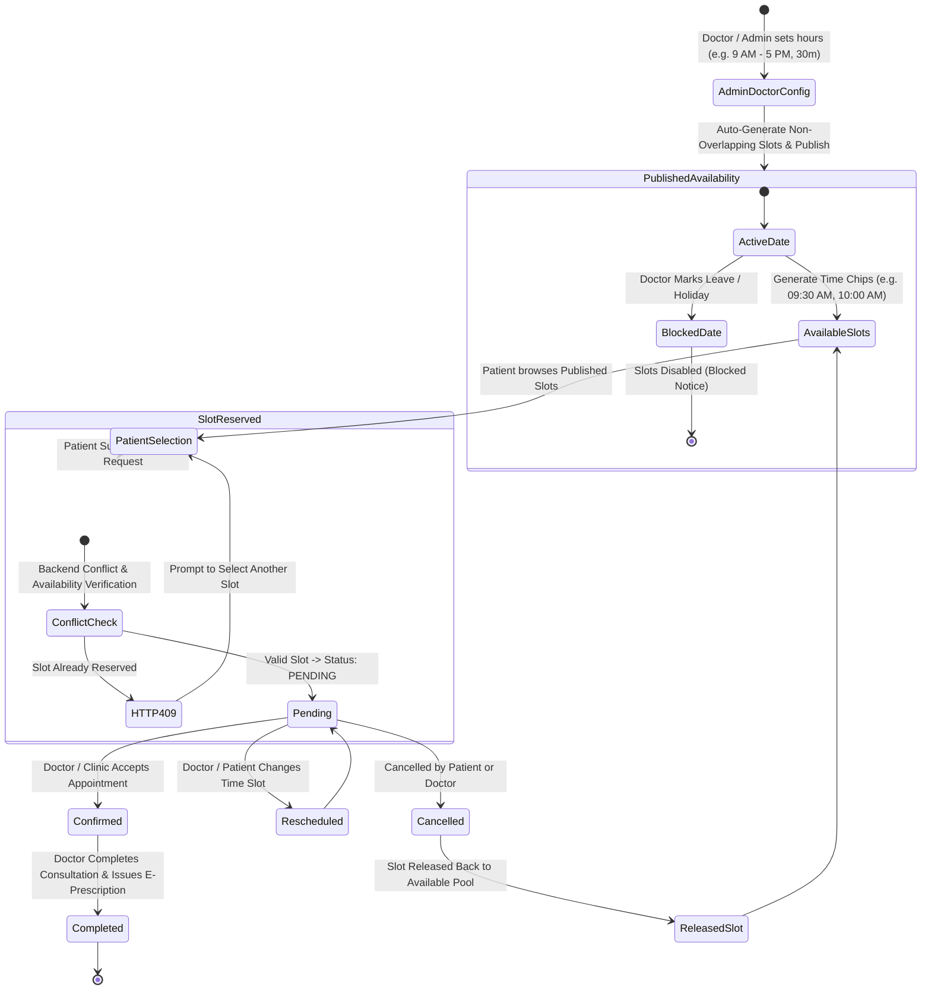
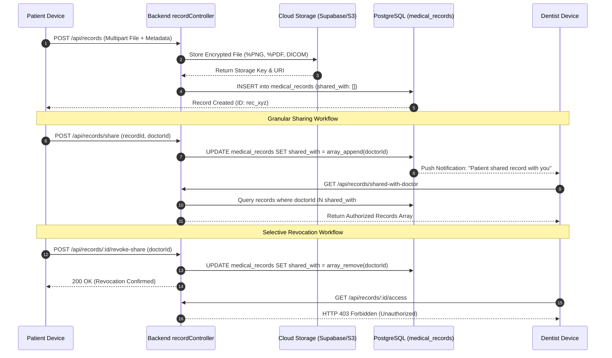

# GS HEALTH (DentaGuru) — Comprehensive Technical & Business Architecture Document

---

## 1. Executive Summary & Problem Statement

### 1.1 Executive Summary
**GS HEALTH (DentaGuru)** is an enterprise-grade, multi-vendor digital dental healthcare platform designed to bridge the gap between patients, verified dental clinics, specialized dentists, and administrative authorities. The platform provides real-time triage, doctor availability scheduling, secure clinical dental records storage, dynamic appointment lifecycles, and a cross-clinic patient referral network.

### 1.2 Problem Statement
Modern dental practice management and patient care suffer from acute operational, clinical, and technological challenges:

1. **Fragmented Patient Records & Imaging Data**:
   - Dental records (OPGs, RVG radiographs, CBCT 3D scans, periodontal charts) are typically isolated in proprietary clinic computers or printed on paper films.
   - Patients lack a secure, mobile-first health repository to own, share, and selectively revoke access to their diagnostic imaging.
2. **Chaotic & Uncoordinated Doctor Scheduling**:
   - Conventional booking portals allow patients to generate arbitrary appointment slots, leading to doctor overbooking, overlapping consultations, or booking during clinic non-working hours.
   - Dentists operating across multiple clinic facilities lack real-time synchronization of their published hours, custom break durations, and holiday blocks.
3. **Specialist Referral & Revenue Attribution Gaps**:
   - General dental practitioners (GDPs) frequently refer complex procedures (e.g., surgical impactions, orthodontic aligners, micro-endodontics) to external specialists via informal channels (WhatsApp/phone calls) with zero traceability, delayed clinical handovers, and lost referral revenue.
4. **Infrastructure Cold-Starts & Mobile Client Downtime**:
   - Cloud-hosted microservice backends (such as containerized instances on serverless or low-cost cloud tiers like Render) undergo sleep states during inactivity. Mobile applications that strictly depend on a single backend endpoint crash or hang when servers spin up, degrading trust and clinical continuity.
5. **Role Security & Administrative Micromanagement**:
   - Single-tier admin systems expose sensitive clinical and financial records to all clinic personnel. There is a lack of granular, permission-based delegation for receptionists, triage coordinators, and verification inspectors.

---

## 2. The Solution Overview

GS HEALTH addresses these industry challenges through a **modular, multi-tier digital dental ecosystem**:

```
+---------------------------------------------------------------------------------------+
|                                    GS HEALTH PLATFORM                                 |
+--------------------------+----------------------------+-------------------------------+
|      PATIENT REALM       |       PROVIDER REALM       |     ADMINISTRATIVE REALM      |
+--------------------------+----------------------------+-------------------------------+
| * Mobile Self-Care Hub   | * Doctor Timeline & Queue  | * Platform Master Dashboard   |
| * Dynamic Slot Booking   | * Slot & Calendar Engine   | * Granular RBAC (13 Perms)    |
| * Cloud Dental Records   | * E-Prescription Studio    | * Clinic & Doctor Verification|
| * Favourite Doctors Roster| * Shared Records Inspection| * Real-time Chat Auditing     |
| * Peer Referral Network  | * Doctor Referral Exchange | * Financial & Growth Analytics|
+--------------------------+----------------------------+-------------------------------+
```

### Key Solution Pillars:
- **Centralized Availability Engine**: Consultation dates, hours, durations (15/30/45/60 min), and blocked holidays are strictly configured and published by Doctors or Administrators. Patients select only valid, published, unbooked slots.
- **Dual-Path 24/7 Resilience Architecture**: All core interactions operate through a dual-channel networking design: primary Node.js/Express REST APIs backed by direct Supabase Cloud GoTrue and PostgreSQL fallback with 35-second cold-start tolerance.
- **End-to-End Real-Time Persistence**: Zero dummy fallback data. State changes in patient records, appointment statuses (`PENDING` -> `CONFIRMED` -> `COMPLETED`), and referral attributions are synchronized in real-time across Supabase PostgreSQL and local storage.
- **Granular Multi-Vendor RBAC**: 5 distinct actor archetypes (Patient, Doctor, Clinic, Sub-Admin, Admin) enforced both in the Flutter UI and via server-side JWT / database Row-Level Security (RLS) policies.

---

## 3. User Cases & Actor Workflows



### 3.1 Patient (Self-Care & Consultation Hub)
1. **Registration & Auth**: Multi-channel login (Mobile OTP, Email/Password, or Biometrics) with optional metadata (location, age, language).
2. **Symptom Reporting & AI Triage**: Report localized symptoms (e.g., toothache, bleeding gums, wisdom tooth pain) with severity ratings and image attachments.
3. **Favourite Doctors**: Save platform dental specialists into `"My Favourite Doctors"` for 1-tap re-booking.
4. **Dynamic Appointment Booking**:
   - Select a verified doctor.
   - Fetch real-time published availability for any selected date in the next 14 to 90 days.
   - Choose an available slot (booked slots are struck through; blocked holiday dates disable progression).
   - Receive instantaneous confirmation and in-app status updates.
5. **Dental Records Repository**: Upload dental X-rays, lab reports, and treatment estimates. Grant time-limited or revocable access to specific specialists.
6. **Patient Referrals**: Refer family and friends to dentists or accredited clinics and monitor referral milestones.

### 3.2 Doctor / Dentist (Clinical Practice & Queue Engine)
1. **Consultation Schedule & Slot Management**:
   - Configure weekly working hours (e.g., 09:00 AM – 05:00 PM).
   - Set consultation slot duration (15m, 30m, 45m, 60m) and trigger auto-generation of non-overlapping slots.
   - Add custom ad-hoc slots or remove specific intervals.
   - Block full dates for leave, holidays, or emergency clinic maintenance with custom explanatory reasons.
2. **Timeline Queue Management**: Real-time roster of upcoming and queued patient visits with patient age, dental complaint, and triage priority.
3. **E-Prescription & Diagnostic Notes**: Issue structured electronic prescriptions with medicine dosages, frequency, duration, diagnostic findings, and digital signatures.
4. **Shared Records Inspection**: Access imaging records explicitly shared by patients for pre-procedure evaluation.
5. **Inter-Doctor Specialist Referrals**: Refer patients requiring specialized procedures (e.g., Maxillofacial surgery, Orthodontic aligners) to partner specialists.

### 3.3 Dental Clinic (Facility & Resource Entity)
1. **Clinic Profile & Credentialing**: Maintain operational details, operating licenses, geographical coordinates, and equipment facilities.
2. **Specialist Roster**: Attach verified in-house and visiting dental consultants.
3. **Facility Appointment Tracking**: Overview of all appointments booked across operating dental chairs.

### 3.4 Sub-Admin (Operational Delegator)
1. **Granular Permission Matrix (13 Fine-Grained Permissions)**:
   - `PROBLEM_VIEW`, `PROBLEM_UPDATE`
   - `ASSIGNMENT_CREATE`, `ASSIGNMENT_VIEW`
   - `DENTIST_VIEW`, `DENTIST_EDIT`
   - `PATIENT_VIEW`
   - `RECORD_VIEW`
   - `ANALYTICS_VIEW`
   - `MANAGE_REFERRALS`
   - `APPOINTMENTS`
2. **Problem Intake Review**: Review submitted patient symptoms, assign platform specialists, and update triage statuses.
3. **Verification Inspection**: Verify clinic registrations and dentist qualifications before platform activation.

### 3.5 Super Admin (System Governance)
1. **Platform Overseer**: Master roster management, global doctor availability overrides, and system-wide setting configurations.
2. **Sub-Admin Governance**: Provision, update permissions for, or suspend Sub-Admin accounts.
3. **Chat Inspection & Audit Trail**: Real-time read-only inspection of patient-doctor communication channels for safety and compliance.
4. **Financial & Growth Analytics**: Track platform-wide consultation completions, active clinics, and patient referral attribution funnels.

---

## 4. Technologies Used

| Tier / Category | Technology / Library | Purpose & Implementation Details |
|---|---|---|
| **Mobile & Web Client** | **Flutter 3.x (Dart SDK >= 3.2.0)** | Cross-platform UI codebase for Android, iOS, and Web. |
| **State Management** | **Flutter Riverpod (`^2.4.9`)** | Reactive, compile-safe dependency injection and decoupled service states. |
| **Routing** | **GoRouter (`^12.1.3`)** | Declarative deep linking, auth state guards, and modal routing. |
| **Local Storage** | **`shared_preferences` & `flutter_secure_storage`** | Secure storage for JWT bearer tokens, active role session persistence, and offline caching. |
| **Security & Auth (Device)** | **`local_auth` (`^2.1.8`)** | Hardware biometric authentication (Fingerprint, Face Unlock) on supported devices. |
| **Push Notifications** | **Firebase Messaging (`^15.0.0`) & `flutter_local_notifications`** | Real-time APNs & FCM push notifications for booking confirmations, reminders, and chat pings. |
| **Backend Framework** | **Node.js (`>=18.0.0`) & Express.js (`^4.19.2`)** | Enterprise REST API server handling business workflows, triage logic, and data orchestration. |
| **Database (Primary/Auth)** | **Supabase Cloud (PostgreSQL 15+)** | Managed PostgreSQL database, GoTrue Authentication, Realtime WebSocket Channels, and RLS policies. |
| **Database (PostgreSQL Driver)** | **PostgreSQL (`pg ^8.22.0`) & Supabase JS (`^2.39.8`)** | Native PostgreSQL client connection and high-performance Supabase query interface. |
| **Cloud Storage** | **Supabase Storage / AWS S3 SDK (`^2.1585.0`)** | Encrypted medical file and dental radiograph storage with signed, time-limited download URLs. |
| **Realtime Engine** | **Socket.io (`^4.7.4`) & Supabase Realtime** | Sub-second patient-doctor messaging, appointment status push updates, and live dashboard metrics. |
| **API Security** | **Helmet (`^7.1.0`), CORS, `express-rate-limit`** | HTTP header hardening, cross-origin resource isolation, and DDoS/brute-force rate limiting. |
| **External Integrations** | **Nodemailer, WhatsApp URL schemes** | Automated email notifications and direct patient referral attribution dispatch via WhatsApp. |
| **Build & Tooling** | **Gradle 8.13, AAPT2, Docker Compose** | Continuous verification, containerization, and release compilation of standalone Android APKs. |

---

## 5. Architectural Topology & Connections

### 5.1 High-Level System Architecture Diagram



---

### 5.2 Dual-Path Resilience Architecture (Cold-Start Safety)

One of the platform's core architectural innovations is its **Dual-Path Zero-Downtime Pipeline**:



---

### 5.3 Doctor Slot Management & Dynamic Appointment Booking Lifecycle



---

### 5.4 Secure Dental Records Storage & Access Revocation



---

## 6. Integration & Security Matrix

| Subsystem / Interface | Transport Protocol | Primary Endpoint / Mechanism | Fallback Mechanism | Security & Authorization Controls |
|---|---|---|---|---|
| **User Authentication** | HTTPS REST / GoTrue SDK | `POST /api/auth/login`<br>`POST /api/auth/register` | Direct `Supabase.instance.client.auth.signInWithPassword()` | JWT Bearer Tokens, Bcrypt salt hashing, Local Biometrics via `local_auth`. |
| **Doctor Availability Engine** | HTTPS REST / PostgreSQL | `GET /api/doctor-availability`<br>`POST /api/doctor-availability` | Direct `doctor_availability` table select/upsert | Role Guard: Patients receive **HTTP 403 Forbidden** on write attempts; Admin/Doctor only. |
| **Appointment State Machine** | HTTPS REST / PostgreSQL | `POST /api/appointments`<br>`PATCH /api/appointments/:id/accept` | Direct `appointments` table insert with slot conflict checks | Unique `(dentist_id, appointment_date, time_slot)` collision prevention; RLS table policies. |
| **Dental Records Storage** | Multipart Form / Signed HTTPS | `POST /api/upload`<br>`GET /api/upload/signed-url` | Direct Supabase Storage Bucket upload (`records`) | Strict `%PNG`, `%PDF`, `%JPEG` binary validation; access gated by patient ownership and explicit `shared_with` doctor ID lists. |
| **Sub-Admin Delegation** | HTTPS REST | `POST /api/admin/sub-admins`<br>`PUT /api/admin/sub-admins/:id` | Direct Supabase `sub_admins` table queries | **Main Admin Exclusive**: Gated by `requireMainAdmin` middleware; fine-grained 13-bit permission bitmask. |
| **Patient Referral Tracking** | HTTPS / WhatsApp URI | `POST /api/referrals`<br>`POST /api/referrals/check-patient` | Direct Supabase `referrals` queries + WhatsApp link generation | Attribution linked to referrer ID; consultation booking updates status to `CONSULTATION_BOOKED`. |
| **Audit & Chat Logs** | WebSocket (WSS) / HTTPS | `GET /api/chat/conversations`<br>`POST /api/chat/send` | Supabase Realtime Channels (`chat_messages`) | Role-based chat access (`requireChatAccess`); non-tamperable append-only audit trail. |

---

## 7. Summary of Architectural Achievements

1. **Zero Dummy Data**: Production data operates directly on Supabase PostgreSQL tables (`users`, `appointments`, `medical_records`, `clinics`, `dentists`, `doctor_availability`, `referrals`, `notifications`). Clean empty states are rendered when tables are uninitialized.
2. **Cold-Start Resilience**: 35-second client network timeouts prevent prematurely failing backend requests during container spin-up, backed by direct Supabase Cloud GoTrue and PostgreSQL queries.
3. **Controlled Scheduling**: Doctor availability is managed top-down by authorized Doctors and Platform Administrators. Patients can only choose valid, published, unreserved slots.
4. **Autonomous Cross-Platform Codebase**: Single Dart codebase targeting Android (valid `%PNG` asset signatures, AAPT2 Gradle build pipeline), Web (`flutter build web --release`), and iOS with strict Riverpod state scoping.

