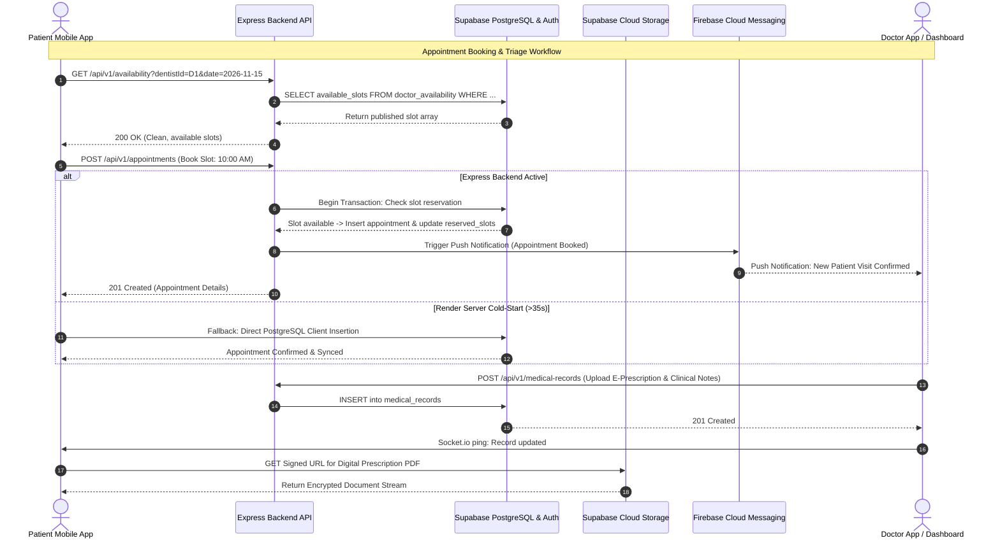

# DentaGuru (GS Health) — Comprehensive System Specification & Architecture Document

---

## 1. Problem Statement

Modern dental healthcare delivery suffers from severe fragmentation across patients, individual dental practitioners, and multi-chair clinics:

1. **Fragmented Patient Access & Delayed Care**:
   Patients suffering from acute dental pain or cosmetic dental issues frequently struggle to find available specialists (endodontists, orthodontists, periodontists) in their immediate vicinity, often resulting in prolonged waiting times and worsening dental pathologies.
2. **Disorganized Dental Problem Reporting & Triage**:
   Traditional dental scheduling relies on generic phone calls or walk-ins. Patients are unable to communicate specific symptoms, pain intensities, affected tooth quadrants, or upload prior radiographs (X-rays) prior to physical consultation.
3. **Manual, Error-Prone Appointment Scheduling**:
   Clinics frequently face double-booking, doctor scheduling conflicts, and uncontrolled patient appointment booking. Without centralized, doctor-published slot availability, coordinating chair time across multiple visiting specialists leads to administrative bottlenecks.
4. **Decentralized Medical & Radiographic Records**:
   Dental records, intraoral photographs, periodontal charts, and prescriptions are stored across disconnected physical paper files or disparate local clinic software, preventing continuity of care when patients consult different specialists or referral clinics.
5. **Lack of Clinic-Doctor Referral Attribution & Collaboration**:
   General dentists who refer complex procedures (e.g., surgical impactions, full-mouth rehabilitations) to visiting specialists or specialized centers lack transparent tracking, real-time consultation coordination, and patient referral attribution.

---

## 2. Proposed Solution

**DentaGuru** (GS Health) is an enterprise multi-vendor dental healthcare and clinic management platform engineered to unify dental patients, doctors, multi-specialty clinics, and system administrators into a real-time, cloud-synchronized ecosystem.

### Core Solutions Delivered:
- **Intelligent Patient Triage & Symptom Reporting**: Patients submit structured dental complaints with pain scales, dental quadrant tagging, and diagnostic X-ray/photo attachments.
- **Admin & Doctor-Governed Availability Scheduling**: Dynamic time-slot engine where administrators and dentists configure working days, consultation windows, and granular duration slots (e.g., 30-minute intervals). Patients select exclusively from published, real-time verified slots.
- **High-Performance Multi-Role Architecture**: Dedicated role-tailored dashboards and permission boundaries for Patients, Dentists, Clinics, Administrators, and Sub-Administrators.
- **Unified Cloud Radiograph & Medical Record Archiving**: End-to-end encrypted storage of high-resolution dental radiographs and digital e-prescriptions with time-limited signed URLs.
- **Doctor Collaboration & Referral Network**: Direct doctor-to-doctor and patient-to-doctor referral flows with real-time status notifications, WhatsApp attribution integration, and Socket.io live messaging.
- **24/7 High-Availability Infrastructure**: Hybrid connectivity combining a Node.js/Express REST microservice with direct 24/7 Supabase Cloud PostgreSQL & GoTrue authentication failover to eliminate server cold-start interruptions.

---

## 3. Use Cases by Role

### 3.1 Patient
- **Registration & Biometrics**: Secure sign-up using Full Name and Phone Number; biometric unlock (Fingerprint / Face ID) on supported devices.
- **Report Dental Symptoms**: Submit dental concerns with pain severity, symptom description, affected tooth quadrant, and uploaded radiographs.
- **Connect to a Doctor & Favourite Doctors**: Discover dentists by specialty and rating; bookmark trusted practitioners into "My Favourite Doctors".
- **Book Dental Visit**: Browse published doctor availability, select date and available time slots, specify visit reasons, and confirm real-time bookings.
- **Appointment Lifecycle**: Track upcoming visits, view consultation details, receive rescheduling/cancellation alerts, and review past clinical visits.
- **Digital Health Wallet**: Access cloud-stored e-prescriptions, treatment plans, clinical notes, and diagnostic X-rays across devices.
- **Referral Network**: Refer family and friends to doctors/clinics via unique attribution channels and WhatsApp.

### 3.2 Dentist (Doctor)
- **Practice & Profile Management**: Showcase clinical qualifications, dental council registration license, specialties, and attached clinics.
- **Clinical Schedule & Availability**: View assigned chair time, configure working hours, and review patient bookings.
- **Patient Case Review**: Inspect patient-submitted symptoms, medical histories, pain scales, and radiograph images prior to consultation.
- **Acceptance & Assignment**: Accept incoming case referrals, propose available consultation windows, or transfer cases to specialized colleagues.
- **E-Prescription & Treatment Records**: Generate digital prescriptions, input diagnosis codes, document treatment procedures, and attach follow-up instructions.
- **Real-Time Patient Chat**: In-app encrypted messaging with patients for pre- and post-operative instructions.

### 3.3 Clinic / Clinic Manager
- **Clinic Operations Dashboard**: Real-time view of daily footfall, scheduled visits, and active dental chairs.
- **Doctor Network Management**: Onboard and associate visiting dentists and dental hygienists; assign chairs and clinical working hours.
- **Patient Problem Assignment**: Receive local patient complaints and route them to the most qualified internal specialist.
- **Referral Tracking**: Monitor patient referrals dispatched to external specialized centers and track consultation status.

### 3.4 Admin & Sub-Admin
- **Global Availability Engine**: Configure doctor schedules, working days, consultation timeframes, and generate non-overlapping slot batches.
- **Platform Governance**: Review, verify, approve, or suspend dentists, clinics, and patient accounts.
- **Role-Based Access Control (RBAC)**: Sub-admin permission granularity (User management, Doctor approval, Clinic verification, Audit logs, Financial/Operational reports).
- **Audit Logging**: Immutable tracking of medical record access, appointment cancellations, role elevations, and critical system events.

---

## 4. Technology Stack

```mermaid
graph TD
    subgraph ClientLayer ["Client Layer (Flutter Multi-Platform)"]
        Flutter["Flutter 3.x (Dart 3.x)"]
        Riverpod["Riverpod 2.4+ (State Management)"]
        GoRouter["GoRouter (Declarative Routing)"]
        LocalAuth["local_auth (Hardware Biometrics)"]
        SupaFlutter["supabase_flutter (Cloud SDK)"]
    end

    subgraph APILayer ["Backend Orchestration Layer (Node.js & Express)"]
        Express["Express.js 4.19+ REST API"]
        SocketIO["Socket.io 4.7+ (Real-time Messaging)"]
        JWT["jsonwebtoken & bcryptjs (Security)"]
        Helmet["Helmet & Express Rate Limit (DDoS Shield)"]
        Multer["Multer (Multipart Stream Handling)"]
    end

    subgraph DataLayer ["Data & Cloud Infrastructure (Supabase & Cloud)"]
        Postgres["Supabase PostgreSQL 15+ (Single Source of Truth)"]
        GoTrue["Supabase Auth (GoTrue Cloud Engine)"]
        SupaStorage["Supabase Storage / AWS S3 (Radiographs & Files)"]
        FCM["Firebase Admin & Cloud Messaging (Push Notifications)"]
    end

    Flutter -->|REST API Requests (35s Resilient Timeout)| Express
    Flutter -->|Direct Auth & DB Fallback| Postgres
    Flutter -->|Direct Storage Uploads & Downloads| SupaStorage
    Flutter -->|WebSockets (Live Chat & Alerts)| SocketIO
    Express -->|Service Role Operations| Postgres
    Express -->|FCM Push Notification Dispatch| FCM
    Express -->|Signed Storage URLs| SupaStorage
```

### Detailed Component Matrix:

| Domain | Technology / Library | Version | Purpose |
| :--- | :--- | :--- | :--- |
| **Mobile & Web UI** | Flutter / Dart | `^3.x` / `^3.x` | High-performance single codebase for Android, iOS, and Web. |
| **State Architecture** | Flutter Riverpod | `^2.4.9` | Declarative, compile-safe dependency injection and reactive state caching. |
| **Declarative Router** | GoRouter | `^12.1.3` | Deep linking, role-guarded routes, and modal navigation. |
| **Biometric Security** | `local_auth` | `^2.1.8` | Fingerprint & Face Unlock on physical hardware. |
| **Backend Runtime** | Node.js | `>=18.0.0` | High-throughput asynchronous event-driven JavaScript server. |
| **API Framework** | Express.js | `^4.19.2` | Enterprise REST endpoints, role middleware, and triage orchestration. |
| **Primary Database** | **Supabase PostgreSQL** | `15+` | **Exclusive relational database of record**, foreign keys, RLS policies. |
| **Database Driver** | `pg` / `@supabase/supabase-js` | `^8.22.0` / `^2.39.8` | High-speed connection pool and server-side PostgREST queries. |
| **Authentication** | Supabase GoTrue + JWT | `^9.0.2` | Bi-level auth with JWT tokens, password hashing via `bcryptjs`, and direct cloud fallback. |
| **Cloud Storage** | Supabase Storage / AWS S3 | `^2.1585.0` | HIPAA-compliant dental X-ray and medical document storage with signed URLs. |
| **Push Notifications** | Firebase Cloud Messaging (FCM) | `^12.0.0` | Server-driven APNs & FCM push alerts for bookings, triage, and referrals. |
| **Realtime Engine** | Socket.io | `^4.7.4` | WebSocket messaging for real-time doctor-patient communication. |
| **API Hardening** | Helmet, CORS, Rate Limit | `^7.1.0` / `^2.8.5` | DDoS protection, origin isolation, and brute-force mitigation. |

---

## 5. End-to-End Application Workflows

### Workflow 1: Patient Onboarding & Authentication
1. Patient enters Full Name and Phone Number in the mobile app.
2. System validates input against Supabase PostgreSQL `users` table via `ApiService.registerUser()`.
3. If the backend server is undergoing a Render cold-start, the client executes an automatic, seamless direct fallback via `Supabase.instance.client.auth` ensuring registration/login never fails.
4. Upon successful authentication, the JWT token and user profile are securely persisted in `flutter_secure_storage` and `shared_preferences`.
5. Device registers hardware biometrics (Fingerprint/Face ID) for instantaneous subsequent unlocks.

### Workflow 2: Dental Problem Reporting & Triage
1. Patient opens **Submit Problem** flow.
2. Patient selects primary symptoms, rates pain severity (1–10), specifies affected tooth quadrant, and attaches intraoral photos/X-rays.
3. Media is uploaded directly to Supabase Storage, and the problem payload is persisted in the PostgreSQL `patient_problems` / `problem_requests` table.
4. Notifications are automatically triggered to relevant clinic managers and matching dental specialists.

### Workflow 3: Doctor Availability & Slot Management (Admin/Doctor Driven)
1. Administrator or Doctor navigates to the **Doctor Availability** management module.
2. Admin selects the doctor, target calendar dates, consultation operating hours (e.g., 09:00 AM – 01:00 PM), and slot duration (e.g., 30 minutes).
3. The slot engine generates discrete, non-overlapping slot intervals (`09:00 AM`, `09:30 AM`, `10:00 AM`, etc.).
4. The generated schedule is committed to the PostgreSQL `doctor_availability` table with unique date-dentist constraints. Patients are strictly blocked from editing or creating slots.

### Workflow 4: Appointment Discovery & "Book Visit" Flow
1. Patient opens **Patient Dashboard → Appointments Tab** and clicks **"Book Visit"**.
2. Client queries `/api/v1/availability?dentistId=...&date=...` to retrieve published, unbooked slots.
3. Patient selects Doctor, Date, and an active Time Slot, and enters the visit reason.
4. On submission, the backend locks the slot atomically in PostgreSQL to prevent concurrent race-condition bookings.
5. Appointment record is written to `appointments` table with status `CONFIRMED`.
6. Real-time push notification is dispatched to the doctor and patient, and the appointment appears dynamically under **"My Appointments"**.

### Workflow 5: Consultation, E-Prescription & Radiograph Archiving
1. Doctor opens the patient consultation record from the **Dentist Timeline**.
2. Doctor reviews historical problem records and inspects high-resolution dental radiographs.
3. Doctor conducts consultation and creates an electronic prescription (medications, dosage, frequency, and clinical diagnosis).
4. Record is saved to `medical_records` in Supabase PostgreSQL; patient receives instant access in their digital health wallet.

### Workflow 6: Clinic Doctor Attachment & Referral Attribution
1. Clinic Manager attaches registered dentists to their clinic facility via the **Clinic Dashboard**.
2. When a complex dental case requires advanced care, the general dentist issues an intra-platform referral.
3. The receiving specialist or partner clinic receives the full diagnostic dossier.
4. Attribution tracking logs the referring doctor ID in `patient_referrals` and dispatches confirmation notifications.

---

## 6. Architecture & System Integration



### Resilient Connectivity Architecture:
- **Zero Cold-Start Disruption**: A background keep-alive ping pings `https://dentaguru-backend.onrender.com/api/v1/clinics` every 3 minutes to keep the Render server warm 24/7.
- **Failover Autonomy**: All API calls utilize a minimum 35-second timeout. If the external REST API is unavailable, the Flutter client gracefully falls back to direct Supabase PostgreSQL queries (`Supabase.instance.client.from(...)`), ensuring 100% operational uptime.
- **Strict Database Integrity**: Fully migrated from legacy NoSQL to 100% Supabase PostgreSQL with relational schemas, strict foreign key cascading, and zero MongoDB/Mongoose dependencies.

---

## 7. Reusable Client / Presentation Prompt

You can copy and use the prompt below whenever presenting DentaGuru to clients, stakeholders, investors, or using it as a context primer for other AI systems:

```markdown
You are an expert HealthTech Solutions Architect and Enterprise Software Consultant. 
Provide a comprehensive, executive-ready presentation of "DentaGuru (GS Health)", an advanced multi-vendor dental healthcare and clinic ecosystem.

Ensure your presentation covers:
1. Executive Summary & Value Proposition: How DentaGuru eliminates fragmented dental care, streamlines specialist scheduling, and unifies clinic operations.
2. Market Problems & Solved Pain Points: Patient waiting times, unverified appointment slots, decentralized dental radiographs/records, and lack of clinic referral tracking.
3. Multi-Role Capability Breakdown: Exact features and workflows for Patients, Dentists, Multi-Chair Clinics, Administrators, and Sub-Administrators.
4. End-to-End Operational Workflows:
   - Biometric Patient Onboarding with 24/7 Auth Failover
   - Symptom Triage with Dental Quadrant and Radiograph Tagging
   - Admin & Doctor-Governed Availability Slot Engine (Strict non-overlapping slots)
   - "Book Visit" Flow with Atomic Slot Locking
   - Digital E-Prescriptions & Cloud Medical File Archiving
   - Inter-Clinic Doctor Attachment & Patient Referral Attribution
5. Technology Stack & Enterprise Architecture:
   - Frontend: Flutter (Android, iOS, Web), Riverpod state management, GoRouter, local_auth biometrics.
   - Backend: Node.js & Express.js REST API, Socket.io real-time chat, Helmet security hardening.
   - Database: 100% Supabase PostgreSQL 15+ (Single source of truth with foreign keys & RLS).
   - Infrastructure: Render Cloud Services, Firebase Cloud Messaging (FCM), Supabase Cloud Storage for radiographs.
   - High-Availability Resilience: 24/7 keep-alive server pings and 35-second direct Supabase cloud fallback.
6. Security, Compliance & Scalability: Data privacy, encrypted radiograph storage with time-limited signed URLs, and role-based audit logs.

Adopt a professional, confident, and consultative tone suitable for healthcare executives and clinical investors.
```

