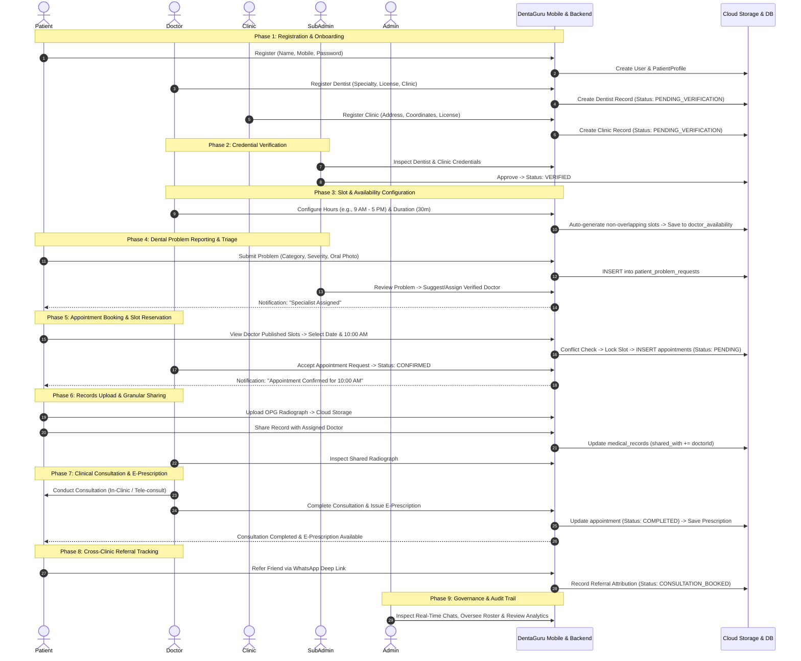

# DentaGuru (GS HEALTH) — Comprehensive Project Documentation

---

## 1. Problem Statement

Modern dental healthcare delivery and clinical practice management operate in an inefficient, siloed, and paper-dependent environment. Patients, dental specialists, clinic owners, and administrative coordinators encounter significant friction across the care continuum:

### 1.1 Inefficient Dental Symptom Triage & Delayed Care
Patients experiencing acute oral symptoms (e.g., localized toothache, bleeding gums, wisdom tooth impaction, periapical swelling) often lack clarity on clinical urgency and specialist alignment. Without preliminary digital triage, patients either delay treatment until irreversible pulpitis occurs or consult general practitioners when specialized interventions (such as Endodontics or Oral & Maxillofacial Surgery) are required.

### 1.2 Uncoordinated Doctor Scheduling & Overbooking
Traditional appointment booking methods rely on manual phone calls, informal WhatsApp chats, or unconstrained booking portals where patients select arbitrary times. This creates severe scheduling issues:
- Overlapping patient consultations and chair conflicts.
- Inability for doctors working across multiple clinics to publish synchronized schedules.
- Absence of configurable slot durations (e.g., 15-minute quick checks vs. 60-minute root canal procedures).
- Difficulty blocking dates for surgical leaves, academic conferences, or clinic holidays.

### 1.3 Fragmented & Inaccessible Dental Records
Dental diagnostic imaging (OPG panoramic X-rays, RVG digital radiographs, CBCT 3D volume scans, intraoral photographs) and treatment plans are stored on localized clinic desktop drives or printed on deteriorating physical films. 
- Patients cannot easily access or port their dental history when switching clinics or consulting visiting specialists.
- When records are shared electronically, they are typically sent unencrypted via chat apps without access control, auditing, or patient-controlled revocation.

### 1.4 Broken Referral Feedback Loops & Specialist Isolation
General dental practitioners (GDPs) routinely refer complex surgical, orthodontic, and implant cases to visiting consultants or external super-specialty centers. 
- These referrals lack digital traceability, structured clinical handovers, and attribution.
- Referring doctors have no visibility into whether the patient completed the consultation, what treatment was rendered, or how referral fee attributions are settled.

### 1.5 Unverified Practitioners & Lack of Clinical Governance
Online healthcare directories frequently list outdated or unvetted provider profiles. Without rigorous multi-tier verification (license validation, clinic facility audits, administrative inspection), patients are vulnerable to unqualified providers, and accredited dental clinics lack a verified badge to demonstrate compliance.

### 1.6 Mobile Client Downtime from Cloud Cold-Starts
Deploying digital healthcare APIs to low-cost or serverless cloud infrastructure (such as containerized instances on Render or AWS) introduces container sleep cycles during inactivity. Standard mobile applications freeze or crash when cold starts occur, disrupting clinical workflows at the point of care.

---

## 2. Proposed Solution

**DentaGuru (GS HEALTH)** is an enterprise-grade, multi-vendor digital dental healthcare platform that unites **Patients**, **Dentists/Doctors**, **Dental Clinics**, **Sub-Administrators**, and **Platform Administrators** into a single synchronized digital ecosystem.

```
+---------------------------------------------------------------------------------------------------+
|                                      DENTAGURU DIGITAL PLATFORM                                   |
+------------------------------+------------------------------------+-------------------------------+
|        PATIENT REALM         |           PROVIDER REALM           |      GOVERNANCE REALM         |
+------------------------------+------------------------------------+-------------------------------+
| • Guided Problem Intake      | • Daily Consultation Queue         | • Master Command Center       |
| • Doctor Discovery & Favs    | • Slot & Availability Engine       | • 13-Permission Sub-Admin RBAC|
| • Published Slot Booking     | • E-Prescription Studio            | • Clinic & Doctor Verification|
| • Cloud Health Vault         | • Shared Imaging Review            | • Financial & Commission Stats|
| • Granular Record Sharing    | • Doctor-to-Specialist Referrals   | • Live Chat Audit Trails      |
| • Peer-to-Peer Referrals     | • Multi-Clinic Chair Synchronization| • Platform Ads & Banners     |
+------------------------------+------------------------------------+-------------------------------+
```

### Core Architectural Solutions:
1. **Top-Down Availability & Dynamic Slot Engine**:
   - Appointment slots are strictly managed by Doctors and Administrators.
   - Configurable consultation windows, auto-generation of non-overlapping slots (15, 30, 45, or 60 min), ad-hoc slot insertion, and full-day holiday blocking.
   - Patients can only select valid, published, unreserved slots. Booked slots are locked in real-time, preventing collisions.
2. **Patient-Governed Cloud Health Vault**:
   - Centralized, encrypted storage for dental records, radiographs, and lab reports.
   - Patients explicitly grant and revoke viewing permissions to specific doctors on demand.
3. **Closed-Loop Referral Network**:
   - Digital tracking of patient-to-patient, doctor-to-doctor, and doctor-to-clinic referrals with automated WhatsApp deep links and milestone status updates (`CONSULTATION_BOOKED` -> `COMPLETED`).
4. **Structured Clinical Practice & E-Prescriptions**:
   - Standardized consultation workflows enabling dentists to record symptoms, diagnoses, treatment notes, and structured digital prescriptions with drug dosages, timings, and instructions.
5. **Granular Multi-Tier Administrative Delegation**:
   - 13 distinct permission toggles allow Super Admins to delegate operational tasks (problem triage, credential verification, appointment auditing) to Sub-Admins without exposing sensitive financial or system settings.
6. **24/7 Dual-Path Resilience Architecture**:
   - Primary Node.js/Express REST API backed by an automatic fallback directly to Supabase Cloud (PostgreSQL & GoTrue Auth) with a 35-second cold-start tolerance, ensuring zero mobile app crashes during server sleep.

---

## 3. Detailed Use Cases by Actor

```mermaid
graph TD
    subgraph Actors ["Platform Roles"]
        P["👤 Patient"]
        D["🩺 Dentist / Doctor"]
        C["🏥 Dental Clinic"]
        SA["🛡️ Sub-Admin"]
        A["👑 Super Admin"]
    end

    subgraph UseCases ["Core Application Use Cases"]
        UC1["Auth & Biometrics"]
        UC2["Problem Reporting & Triage"]
        UC3["Doctor Discovery & Favourites"]
        UC4["Slot Publishing & Schedule"]
        UC5["Appointment Booking & Lifecycle"]
        UC6["Consultation & E-Prescription"]
        UC7["Dental Records & Sharing"]
        UC8["Referral Attribution Network"]
        UC9["Verification & Credentialing"]
        UC10["Sub-Admin RBAC Delegation"]
        UC11["Chat & Compliance Audit"]
    end

    P --> UC1
    P --> UC2
    P --> UC3
    P --> UC5
    P --> UC7
    P --> UC8

    D --> UC1
    D --> UC4
    D --> UC5
    D --> UC6
    D --> UC7
    D --> UC8

    C --> UC1
    C --> UC3
    C --> UC5
    C --> UC9

    SA --> UC2
    SA --> UC8
    SA --> UC9
    SA --> UC10

    A --> UC4
    A --> UC9
    A --> UC10
    A --> UC11
```



### 3.1 Patient Use Cases
* **UC-P01: Secure Authentication & Profile Setup**
  - Register or sign in via Mobile Phone + OTP, Email + Password, or Device Biometrics (Fingerprint / Face Unlock).
  - Manage demographic details, age, emergency contact, preferred languages, and profile photo.
* **UC-P02: Dental Problem Reporting & Triage**
  - Select from pre-defined dental symptom categories (Toothache, Bleeding Gums, Cavity, Wisdom Tooth Pain, Orthodontic Issues, etc.).
  - Provide problem descriptions, select severity levels (*Mild*, *Moderate*, *Severe*), and attach oral photographs.
  - Track triage review status (*Pending Admin Review*, *Dentist Suggested*, *Confirmed*).
* **UC-P03: Doctor Discovery & Favourite Doctors Management**
  - Browse verified platform dentists by specialty, clinic location, experience, and ratings.
  - Add doctors to **"My Favourite Doctors"** with instant local and cloud synchronization.
  - Remove doctors from favourites with immediate counter updates.
* **UC-P04: Published Appointment Booking**
  - Select an accredited doctor and choose any available date over the next 14 to 90 days.
  - View published consultation slots (e.g., `09:30 AM`, `10:30 AM`). Blocked dates display clear holiday notices; booked slots are disabled.
  - Confirm booking with automatic collision detection.
* **UC-P05: Appointment Tracking & Management**
  - View upcoming visits with QR code check-in strings and doctor consultation details.
  - Access past visit history.
  - Request rescheduling or cancel appointments with reason capture.
* **UC-P06: Personal Dental Records & Selective Sharing**
  - Upload radiographs, lab reports, and treatment plans in PDF, JPEG, or PNG formats.
  - View record thumbnails and inspect full documents.
  - Share specific diagnostic records with selected platform doctors.
  - Revoke a doctor’s access to any record at any time.
* **UC-P07: Patient Referrals & WhatsApp Sharing**
  - Refer family or friends to dentists or clinics via pre-filled WhatsApp referral messages.
  - Monitor referred patients and consultation booking milestones.
* **UC-P08: Secure Patient-Doctor In-App Chat**
  - Chat in real-time with assigned dentists regarding pre-procedure instructions or post-operative recovery.

---

### 3.2 Dentist / Doctor Use Cases
* **UC-D01: Professional Profile & Credential Submission**
  - Maintain clinical specialty (Periodontics, Endodontics, Orthodontics, Prosthodontics, Oral Surgery, etc.), qualifications (BDS, MDS), license numbers, consultation fees, and affiliated clinics.
* **UC-D02: Working Hours & Availability Slot Management**
  - Configure daily consultation start times (e.g., `09:00 AM`) and end times (e.g., `05:00 PM`).
  - Choose slot duration intervals (15, 30, 45, or 60 minutes) and auto-generate non-overlapping slots.
  - Add custom time slots or remove specific slot chips.
  - Block specific dates for holidays or leaves with custom reasons (e.g., *"Attending IDA Conference"*).
* **UC-D03: Consultation Queue & Patient Management**
  - View daily patient consultation queue with triage severity, patient age, and reported complaints.
  - Accept or reject assigned consultation requests.
  - Check in patients using QR verification.
* **UC-D04: Clinical Consultation & E-Prescriptions**
  - Conduct dental consultations and log clinical findings, diagnosis, and treatment procedures.
  - Issue structured electronic prescriptions (medication name, dosage, frequency, food instructions, course duration).
  - Mark consultations as **COMPLETED**, which updates appointment states and referral attributions.
* **UC-D05: Patient Shared Records Review**
  - Access clinical records and radiographs shared by patients for pre-operative planning.
  - View audit notifications when a patient revokes record access.
* **UC-D06: Specialist-to-Specialist Patient Referrals**
  - Refer patients requiring secondary care to accredited platform colleagues.
  - Track patient journey across referred clinics.

---

### 3.3 Dental Clinic Use Cases
* **UC-C01: Facility Profile & Verification**
  - Register clinic name, trade license, full address, city, pincode, GPS coordinates, and contact details.
  - Submit documents for platform accreditation.
* **UC-C02: Attached Doctor Management**
  - Onboard and associate in-house and visiting dentists to clinic branches.
  - Review doctor consultation fees and specialty coverage.
* **UC-C03: Clinic-Wide Appointments & Chair Utilization**
  - Monitor all upcoming patient visits scheduled across the clinic's associated dentists.
  - Track patient arrival statuses and completed treatments.

---

### 3.4 Sub-Admin Use Cases
* **UC-SA01: Delegated Operational Login**
  - Authenticate with dedicated Sub-Admin credentials. The interface dynamically activates only permitted modules based on a 13-bit permission matrix.
* **UC-SA02: Patient Problem Review & Specialist Assignment**
  - View incoming patient problem submissions (`PROBLEM_VIEW`).
  - Match patient symptoms with accredited dental specialists and assign doctors (`ASSIGNMENT_CREATE`).
  - Update triage status to *Dentist Suggested* or *Admin Reviewed* (`PROBLEM_UPDATE`).
* **UC-SA03: Provider Credential Verification**
  - Inspect dentist qualification certificates and dental council registration numbers (`DENTIST_VIEW`, `DENTIST_EDIT`).
  - Audit dental clinic infrastructure and approve or reject verification applications.
* **UC-SA04: Referral Oversight & Appointment Auditing**
  - Track cross-clinic referral volumes (`MANAGE_REFERRALS`).
  - Review appointment bookings and scheduling metrics (`APPOINTMENTS`).

---

### 3.5 Super Admin Use Cases
* **UC-A01: Master Operations Dashboard**
  - Real-time command center displaying platform metrics: total patients, verified dentists, active clinics, total appointments, completed visits, and revenue.
* **UC-A02: Global Doctor Slot & Availability Overrides**
  - Access any registered doctor's availability roster.
  - Modify working hours, re-generate slot intervals, or block dates on behalf of doctors or clinics.
* **UC-A03: Sub-Admin Account Provisioning & RBAC Management**
  - Create Sub-Admin accounts with custom credentials.
  - Toggle each of the 13 permissions individually in real-time.
  - Activate, deactivate, or delete Sub-Admin accounts.
* **UC-A04: Live Chat Inspection & Compliance Audit**
  - Inspect patient-doctor conversation threads in real-time to ensure clinical compliance, patient safety, and adherence to medical conduct codes.
* **UC-A05: Platform Ads & Banner Management**
  - Manage in-app dental educational banners, promotional notices, and product showcase carousels.

---

## 4. Technology Stack Used

Every technology listed below is actively utilized within the DentaGuru codebase:

```
+---------------------------------------------------------------------------------------------------+
|                                  DENTAGURU FULL TECHNOLOGY STACK                                  |
+====================+===================================+==========================================+
| Layer              | Technology / Package              | Exact Version & Implementation Purpose   |
+====================+===================================+==========================================+
| Frontend Client    | Flutter Framework / Dart SDK      | SDK >= 3.2.0 < 4.0.0 (Android & Web)     |
| State Management   | flutter_riverpod                  | ^2.4.9 (Reactive state, decoupled DI)    |
| Routing            | go_router                         | ^12.1.3 (Deep-linking & role route guards)|
| Secure Storage     | flutter_secure_storage            | ^9.0.0 (Encrypted JWT token storage)     |
| Key-Value Storage  | shared_preferences                | ^2.2.2 (Role sessions & local cache)     |
| Biometrics         | local_auth                        | ^2.1.8 (Fingerprint & Face biometric auth|
| API Networking     | http                              | ^1.2.0 (REST communication with 35s to)  |
| Cloud Auth / DB    | supabase_flutter                  | ^2.5.0 (GoTrue auth & PostgreSQL client) |
| Push Notifications | firebase_messaging & core         | ^15.0.0 / ^3.1.0 (FCM cloud alerts)      |
| Local Alerts       | flutter_local_notifications       | ^17.0.0 (Device notification channels)   |
| Telemetry          | firebase_crashlytics & analytics  | ^4.0.0 / ^11.0.0 (Error logging & metrics|
| Media Handling     | image_picker                      | ^1.1.2 (Camera / Gallery X-ray selection)|
| Styling & Theme    | google_fonts, flutter_spinkit     | ^6.1.0 / ^5.2.0 (Material 3 typography)  |
+--------------------+-----------------------------------+------------------------------------------+
| Backend Server     | Node.js / Express.js              | Node >= 18.0.0 / Express ^4.19.2         |
| Primary Database   | Supabase PostgreSQL 15+           | Relational database, RLS, Realtime       |
| Database Engine    | PostgreSQL / Supabase SDK         | pg ^8.22.0 / @supabase/supabase-js ^2.39 |
| Cloud Database SDK | @supabase/supabase-js             | ^2.39.8 (Server-side DB orchestration)   |
| Authentication     | jsonwebtoken & bcryptjs           | ^9.0.2 / ^2.4.3 (JWT tokens & hashing)   |
| File Uploads       | multer                            | ^2.0.0 (Multipart stream handling)       |
| Cloud Storage      | aws-sdk / Supabase Storage S3     | ^2.1585.0 (Signed URLs & bucket storage) |
| Realtime Sockets   | socket.io                         | ^4.7.4 (Live chat & status events)       |
| Security Hardening | helmet, cors, express-rate-limit  | ^7.1.0 / ^2.8.5 / ^7.2.0 (DDoS defence)  |
| Email Dispatch     | nodemailer                        | ^9.0.5 (SMTP OTP and account recovery)   |
+--------------------+-----------------------------------+------------------------------------------+
| Cloud & DevOps     | Render Cloud, Supabase, Gradle    | Render web services, Gradle 8.13 AAPT2   |
+--------------------+-----------------------------------+------------------------------------------+
```

---

## 5. End-to-End Application Workflow

The complete end-to-end operational lifecycle of DentaGuru spans 9 integrated phases:



### Detailed Phase Breakdown:

#### Phase 1: Multi-Role Registration & Onboarding
1. **Patient Registration**: The user registers with Full Name and a valid 10-digit mobile number. Optional fields (age, gender, blood group, city, location) can be provided immediately or updated later.
2. **Dentist Registration**: Requires full name, contact number, clinical dental specialty, medical council license number, and associated clinic name. The account enters a `PENDING_VERIFICATION` state.
3. **Clinic Onboarding**: Requires clinic facility name, operating address, geographic coordinates, and clinic trade license.
4. **Session Persistence**: Sessions are saved locally via `SharedPreferences` and encrypted JWT tokens via `FlutterSecureStorage`.

#### Phase 2: Provider Verification & Credentialing
1. Admins or Sub-Admins with `DENTIST_VIEW` and `DENTIST_EDIT` permissions review submitted dental council license numbers and clinic accreditations.
2. Upon approval, provider statuses transition to `VERIFIED`, activating them in the patient-facing directory and booking engine.

#### Phase 3: Doctor Working Hours & Availability Slot Management
1. Verified doctors (or Admins acting on their behalf) access the **Slot Management Engine**.
2. Working hours (e.g., `09:00 AM` to `05:00 PM`) and slot intervals (15, 30, 45, or 60 minutes) are defined.
3. The system generates non-overlapping slots. Doctors can add ad-hoc slots or remove specific intervals.
4. Doctors can toggle full-day blocks for leaves, surgery days, or holidays, providing a mandatory explanation note.
5. Published configurations persist in the `doctor_availability` PostgreSQL table.

#### Phase 4: Dental Problem Reporting & Triage
1. Patients submit problem requests selecting from structured categories (e.g., *Toothache & Cold Sensitivity*, *Wisdom Tooth Pain*, *Root Canal Treatment*).
2. Patients select pain severity (*Mild*, *Moderate*, *Severe*) and upload optional intraoral images.
3. Triage Sub-Admins review submissions, suggest accredited specialists, and assign the case to the most appropriate doctor.

#### Phase 5: Dynamic Appointment Booking & Slot Reservation
1. Patients open the **Book Visit** flow and choose their preferred doctor.
2. The app fetches live availability for the selected doctor and date.
3. Dates with holiday blocks display warning banners and disable slot selection.
4. The patient selects an available slot. The backend performs collision detection against existing bookings:
   - If a collision occurs, the server returns `HTTP 409 Conflict`, prompting the patient to select another slot.
   - If valid, an appointment record is created with initial status `PENDING`.
5. The doctor reviews the request and marks it `CONFIRMED`. If the patient cancels, the slot is immediately released back to the available pool.

#### Phase 6: Secure Dental Records & Access Revocation
1. Patients upload dental radiographs (RVG, OPG, CBCT) or PDF reports to their private vault. Files are securely stored in cloud buckets.
2. Patients explicitly share a record with their treating doctor. The backend updates the record's `shared_with` authorization list.
3. The treating doctor gains read access to review diagnostic imaging.
4. The patient can revoke access at any point. Once revoked, subsequent doctor fetch attempts return `HTTP 403 Forbidden`.

#### Phase 7: Clinical Consultation & E-Prescription Issuance
1. The patient attends the scheduled appointment.
2. The dentist conducts the examination and records clinical diagnoses, findings, and tooth numbering.
3. The dentist issues an electronic prescription specifying drug names, dosages, timings, and dietary instructions.
4. The dentist marks the visit `COMPLETED`. The patient immediately receives their digital summary and E-prescription in the app.

#### Phase 8: Patient & Doctor Referral Attribution
1. Patients or doctors generate tracked referral links dispatched via WhatsApp.
2. When the referred patient registers and completes their consultation, the backend automatically updates the referral status to `CONSULTATION_BOOKED` and then `COMPLETED`, ensuring complete attribution transparency.

#### Phase 9: Administrative Oversight & Governance
1. Super Admins monitor platform KPIs, consultation revenues, and active clinic volumes.
2. Admins review live patient-doctor chats in read-only audit mode to ensure clinical safety.
3. Sub-Admin accounts and their 13 granular operational permissions are managed dynamically.

---

## 6. Verification & Quality Standards

- **Zero Dummy Data**: Production state strictly pulls from database tables (`users`, `appointments`, `medical_records`, `clinics`, `dentists`, `doctor_availability`, `referrals`). Clean empty states are displayed when no data exists.
- **Cold-Start Resilience**: 35-second client timeouts accommodate backend container spin-up on Render, backed by direct Supabase Cloud GoTrue and PostgreSQL queries.
- **Strict APK Build Standards**: Verified Android launcher icon `%PNG` signatures and Gradle 8.13 AAPT2 compilation rules ensuring release APK stability (`app-release.apk`).
- **Comprehensive Test Suite**: Automated verification across unit, widget, and integration tests covering role authentication, availability generation, appointment state transitions, and record sharing.

